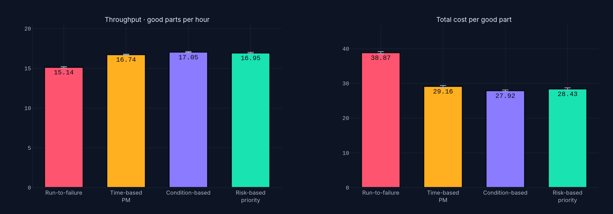
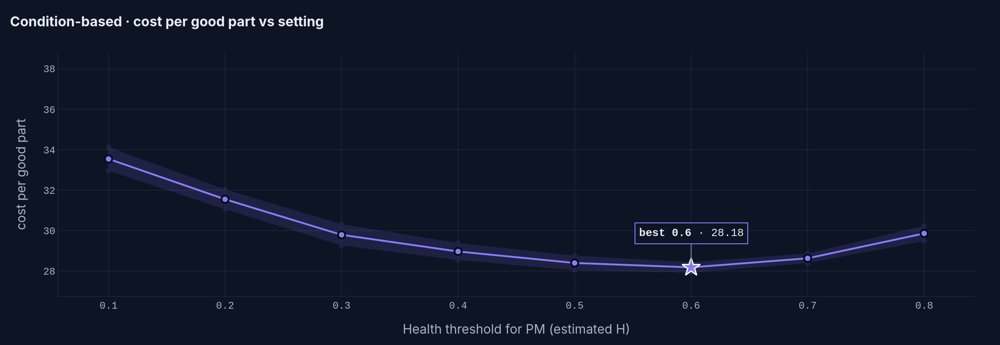
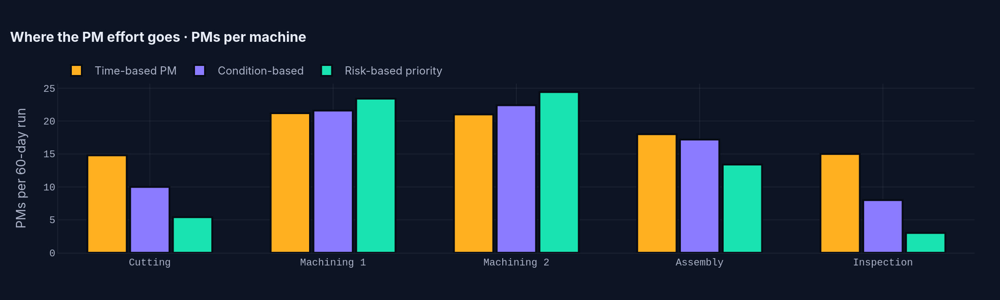
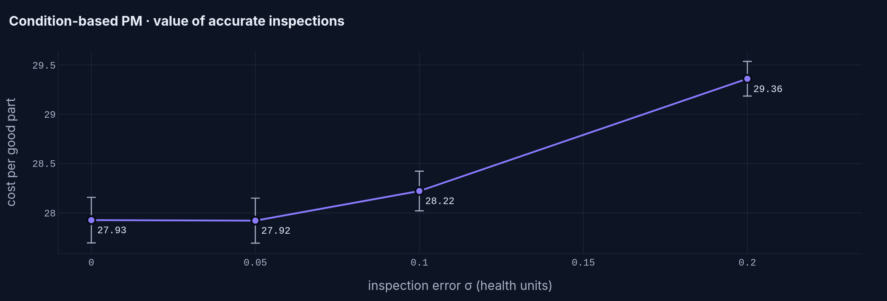
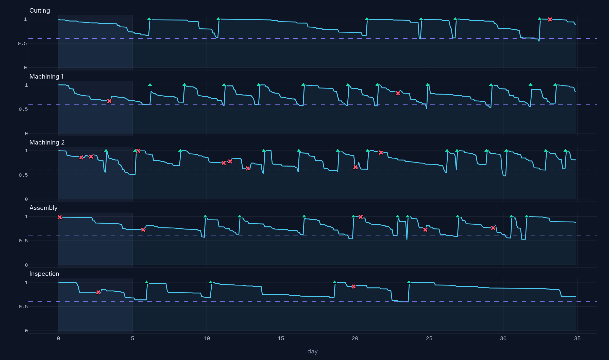

# Asset Health Digital Twin

**A health index drives the failure rate of every machine in a SimPy production line, so maintenance policies can be compared on throughput, downtime and cost per good part, not just on how often they fail.**



> ⚠️ **All data are simulated and every parameter is illustrative.** No real plant or company data is used. "Digital twin" here means a simulation model that mirrors each asset's condition. It is not connected to live sensors.

---

## The problem

Maintenance decisions are often made one asset at a time ("this machine looks worn, fix it"). In a production line that is not enough:

- a machine that fails stops the flow, starving the stations after it and blocking the ones before it;
- preventive maintenance (PM) also takes the machine offline and keeps the crew busy;
- the crew is shared, so *which* machine gets served first matters.

This project links an **asset health model** (degradation → failure risk) to a **discrete-event line simulation**. The question it answers is: *which maintenance policy gives the most good parts at the lowest cost?*

It connects two earlier projects of mine: the health/priority scoring idea from [sutm-predictive-maintenance-dashboard](https://github.com/Muat01/sutm-predictive-maintenance-dashboard) and the line model from [production-line-simulation-simpy](https://github.com/Muat01/production-line-simulation-simpy).

## Features

- **Health model per machine.** A gamma-process degradation of a health index H ∈ [0, 1] that wears down only while the machine runs, plus a proportional-hazards failure rate λ(H) = λ₀·e^{γ(1−H)}. H = 0 is a certain failure.
- **Noisy condition monitoring.** Inspections every shift return H plus measurement error, like a visual or thermal inspection score.
- **Four maintenance policies:** run-to-failure, time-based PM, condition-based PM and risk-based priority (risk = P(fail) × consequence, with the crew serving the riskiest machine first).
- **Shared maintenance crew** (SimPy `PriorityResource`): corrective work always comes first. Corrective repair is imperfect (it restores 30% of lost health); PM restores the machine to new.
- **Fair experiments.** Each policy is tuned on separate seeds, then all are evaluated on 20 common seeds (common random numbers) with 95% confidence intervals and paired differences.
- **Streamlit app** with a live what-if comparison, a "health twin" view of every machine over time, the full study results and the method.

## Results (simulated, illustrative parameters)

60 days of 24/7 operation after a 7-day warm-up, 20 replications per policy, settings tuned on 10 separate seeds.

| Policy | Tuned setting | Good parts / h | Cost per good part | Failures / run | PMs / run |
|---|---|---|---|---|---|
| Run-to-failure | none | 15.14 ± 0.09 | 38.87 ± 0.31 | 135.6 | 0 |
| Time-based PM | every 60 operating h | 16.74 ± 0.06 | 29.16 ± 0.24 | 36.3 | 90.3 |
| **Condition-based** | **PM when Ĥ < 0.6** | **17.05 ± 0.06** | **27.92 ± 0.23** | **31.6** | **77.5** |
| Risk-based priority | PM when risk ≥ 0.10 | 16.95 ± 0.08 | 28.43 ± 0.29 | 38.0 | 69.7 |

*± is the 95% confidence-interval half-width.*

**Key findings**

1. **Condition-based PM was the best policy in this model.** Compared with run-to-failure it gave **+12.7% throughput** (paired difference +1.92 ± 0.08 parts/h), **−28% cost per good part** (−10.95 ± 0.31) and **77% fewer failures**. Total downtime fell from 437 to 212 machine-hours per run.
2. **Every policy has a sweet spot.** Too little PM lets machines wear out; too much wastes capacity and crew time. The cost curve is U-shaped for all three preventive policies.
   
3. **Ranking by risk did *not* beat plain condition-based PM** (+0.51 ± 0.18 cost per part, +6.5 failures per run, both significant). The risk score gives most of the PM effort to the Machining bottleneck and very little to Cutting and Inspection (3 PMs per run for Inspection vs 8 under CBM). Those machines then fail more, and because they sit at the start and end of the line, their failures still stop the flow. **Lesson:** a consequence weight based only on station load underestimates how much non-bottleneck stations matter. A better consequence model would come from the simulation itself.
   
4. **Inspection accuracy matters, but not linearly.** With CBM, raising the inspection error from σ = 0.05 to 0.10 health units barely changes cost (27.92 → 28.22). At σ = 0.20, cost rises 5% (29.36) and PMs rise 57%, because noisy readings trigger unnecessary overhauls.
   

**Health twin view:** each machine's health under condition-based PM (✕ failure, ▲ PM, dashed line = threshold):



### Limitations (please read)

- **All parameters are illustrative.** Degradation rates, hazard sensitivity, repair times and costs were chosen to be plausible, not fitted to real data. The *ranking* of policies can change with other parameters. Use the app to test this yourself.
- The health index is a single number per machine. Real assets have several failure modes.
- Inspections are free and instant in the model; PM is a perfect overhaul; the crew needs no travel time.
- The risk-based policy uses a simple load-based consequence weight (see finding 3). Its result says something about that heuristic, not about risk-based maintenance in general.
- The tuned setting was chosen on 10 seeds from a coarse grid, so the true optimum may lie between grid points.

## Getting started

```bash
git clone https://github.com/Muat01/asset-health-digital-twin.git
cd asset-health-digital-twin
python -m venv .venv
.venv\Scripts\activate            # Windows  (macOS/Linux: source .venv/bin/activate)
pip install -r requirements.txt

streamlit run app.py              # interactive app
python -m pytest                  # 24 tests (model, statistics, charts, app)
python experiments.py             # re-run the full study (~5 min) -> results/
python experiments.py --quick     # fast smoke test
python make_docs.py               # re-export README figures (needs kaleido)
```

Quick one-off run in Python:

```python
from line import run
from policies import Policy
r = run(Policy("CBM", threshold=0.6), days=60, seed=1)
print(r["throughput_per_h"], r["cost_per_part"], r["failures"])
```

## Data availability

No external data. Everything is generated by the simulation from the parameters in `line.py` (`default_line`, `MaintenanceConfig`) and `health.py` (`HealthParams`). The CSV files in `results/` are the outputs of `python experiments.py` and can be reproduced exactly, because all seeds are fixed.

## Project structure

```
asset-health-digital-twin/
├── app.py                 # Streamlit app (what-if, health twin, study, method)
├── health.py              # degradation, hazard, failure probability, inspections
├── policies.py            # RTF / TBM / CBM / RBM definitions, crew priorities
├── line.py                # SimPy line with health-driven failures and a shared crew
├── experiments.py         # replications, 95% CI, sweeps, tuning, paired comparison
├── charts.py              # Plotly figure builders
├── ui.py                  # CSS and HTML components
├── theme.py               # design tokens (colours, fonts)
├── make_docs.py           # exports docs/ figures
├── results/               # study outputs (CSV)
├── docs/                  # README figures
├── tests/                 # pytest + Streamlit AppTest
├── .streamlit/config.toml
├── requirements.txt
└── LICENSE
```

## Method in short

| Element | Model |
|---|---|
| Degradation | Gamma process on operating hours: ΔH ~ Gamma(Δt / (L·c²), c²), mean life L = 120 to 300 h, c = 0.3 |
| Failure rate | λ(H) = λ₀ · exp(γ(1 − H)), γ = 3, so a fully worn machine fails 20× more often than a new one; H = 0 means certain failure |
| Failure sampling | Cumulative-hazard clock (Exp(1) threshold), which keeps random numbers aligned across policies |
| Repairs | Corrective: mean 3 h after the crew arrives, restores 30% of lost health. PM: mean 1.5 h, restores H = 1 |
| Costs | Line 400/h, corrective repair 2000, PM 600 (illustrative cost units) |
| Line | Cutting (2.0 min) → Machining ×2 (6.0 min) → Assembly (2.6 min) → Inspection (2.2 min), buffers of 5, scrap 0.5 to 3% |

## Possible extensions

- Learn the consequence weight of each machine from simulation (e.g. throughput lost per failure hour) instead of station load.
- Opportunistic maintenance: service other worn machines while the line is already stopped.
- Fit degradation parameters to a public run-to-failure dataset (e.g. NASA C-MAPSS) to replace the illustrative values.
- Multiple failure modes per machine and spare-parts inventory.
- Optimise thresholds with a proper optimiser (e.g. Bayesian optimisation) instead of a grid.

## Author

**Muatasem Hadi** · MEng Industrial Engineering, Telkom University, Bandung
[LinkedIn](https://www.linkedin.com/in/muatasem-hadi) · [GitHub](https://github.com/Muat01)

Licensed under the MIT License.
